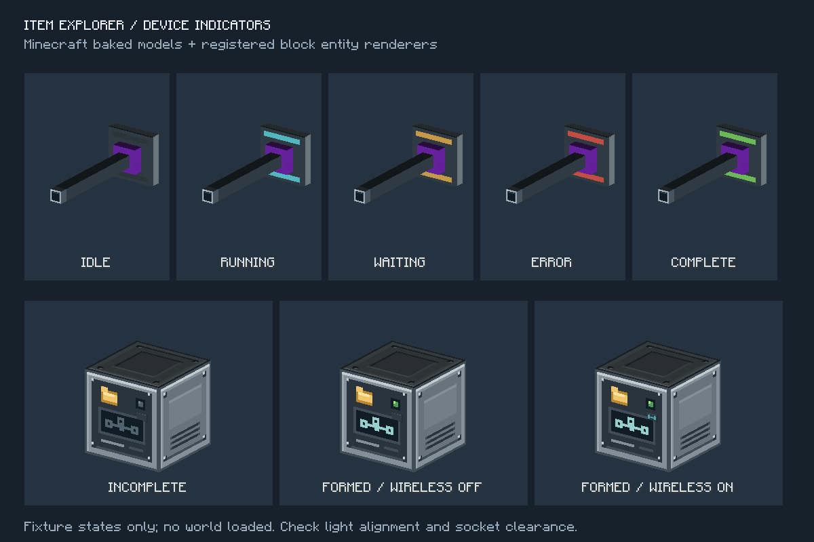
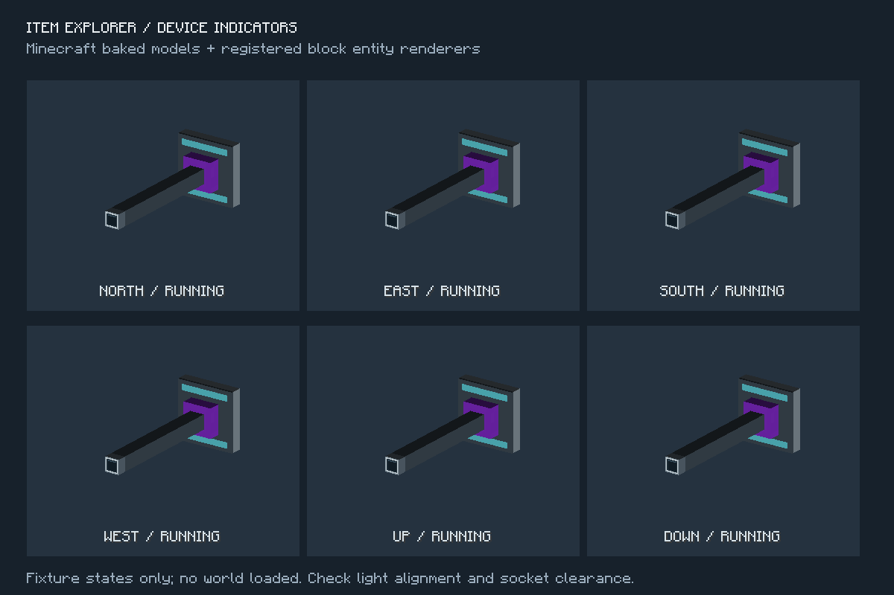

# 设备运行状态灯验收

日期：2026-10-22。开发版本：0.5.1-dev；Minecraft 1.20.1 / Forge 47.0.0 / Java 17。

## 行为

- 机器接口：待机暗灯、运行青色脉冲、缺料／满盘／断线等待琥珀灯、数据保护／干扰／绑定异常红灯，整批交付后绿灯短亮 20 tick。
- 完成灯不保存到 NBT，取消与读档不重播；运行存档先显示等待，重新检查后更新。
- 六向安装共用同一个小型灯带模型，脉冲仅在客户端计算。服务器只在灯态变化时更新方块状态。
- 基站保留原有结构绿灯，新增独立青色无线灯；仅在结构完整且已开启加入网络时亮起。结构失效不会清除保存的联网偏好。
- 新增方块状态后开发协议升为 18，防止与发布版 0.5.0 混连。已有存档缺失的新属性使用默认值，再从设备实际状态重算。

## 自动验证

`powershell -NoProfile -ExecutionPolicy Bypass -File .\dev.ps1 build runGameTestServer --console=plain`

构建成功，**247 项必需 GameTest 全部通过**。新增 7 项机器外观测试与 4 项基站外观测试，覆盖缺料与恢复、完成到期、取消、读档、保护数据、断线重连、六向保留设备身份、独立无线开关、结构拆装修复及旧方块状态读取。

`node scripts/check-logistics-models.mjs`

16 种磁盘／接口／控制器模型组合通过；检查包含新增动态灯片与静态机壳的面间距，未发现共面或不超过 1/32 模型单位的重叠。

## 客户端渲染

`powershell -NoProfile -ExecutionPolicy Bypass -File .\dev.ps1 build runClient --init-script scripts/device-client-test.init.gradle --console=plain`

独立客户端正常加载并退出，探针 PASS。30 种机器状态与朝向组合、16 种基站状态与朝向组合均能解析烘焙模型和纹理，且渲染器注册有效。下图使用 Minecraft 实际模型与方块实体渲染器，在测试预览界面中绘制；未加载玩家存档。

已目视检查状态色、六向灯片对齐、插座遮挡与基站两种指示灯的区别。六向预览分别将相机转向各安装面，因此看起来朝向相同，用于核对静态模型和动态灯片的变换一致性。这不是世界内光照、光影包、远景或大规模设备性能验收；运行脉冲的连续观感也不由静态截图证明。

## 产物

`build/libs/itemexplorer-1.20.1-0.5.1-dev.jar`，535124 字节。

SHA-256：`02e7426e358ffc8f01172ba4e04b6a970353d9bcda71e0ac266ef4e482de12ea`。

已核对版本元数据、两个新增渲染器、灯片模型和最终几何；JAR 不包含 GameTest 或客户端验收探针。
